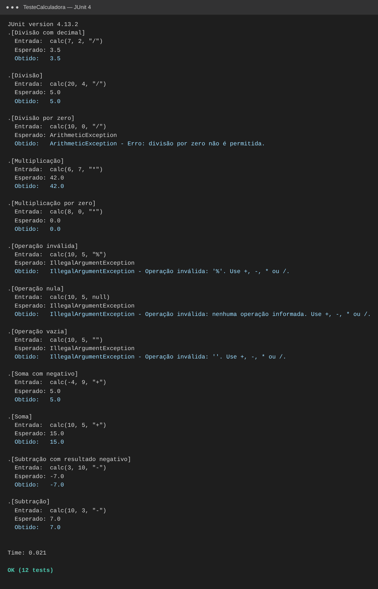
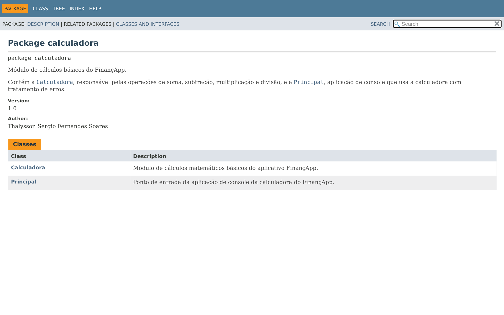
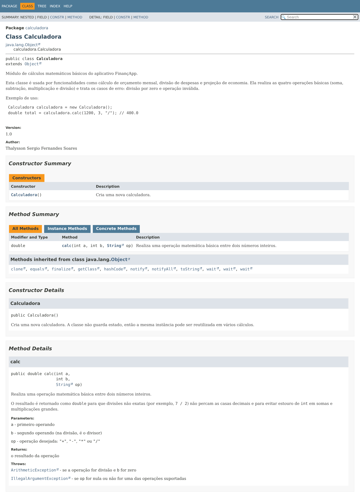

# projeto_calculadora — FinançApp

Módulo de cálculos matemáticos básicos do **FinançApp**, startup fictícia que desenvolve um aplicativo mobile de controle de finanças pessoais. A calculadora é usada em funcionalidades como cálculo de orçamento mensal, divisão de despesas e projeção de economia.

> **Aluno:** Thalysson Sergio Fernandes Soares — RA 252007
> **Curso:** Análise e Desenvolvimento de Sistemas — FACENS
> **Repositório:** https://github.com/thalyssxn/projeto_calculadora

---

## Descrição do projeto

Projeto Java com a classe `Calculadora`, que realiza soma, subtração, multiplicação e divisão de números inteiros por meio do método `calc(int a, int b, String op)`. Além da implementação, o projeto passou por testes unitários, tratamento de erros, refatoração, documentação JavaDoc e versionamento no GitHub.

## Objetivo da atividade

Aplicar na prática os conceitos de qualidade de software:

- testes funcionais e testes unitários;
- tratamento de erros;
- refatoração de código;
- documentação técnica (comentários e JavaDoc);
- versionamento com Git e GitHub.

## Tecnologias utilizadas

| Tecnologia | Uso |
|---|---|
| Java 17+ | Linguagem do projeto |
| JUnit 4.13.2 | Testes unitários |
| Maven | Build e gerenciamento de dependências |
| JavaDoc | Geração da documentação HTML (`docs/`) |
| Git e GitHub | Versionamento e repositório remoto |

## Estrutura do projeto

```
projeto_calculadora/
├── pom.xml
├── README.md
├── docs/                         ← documentação JavaDoc (abrir docs/index.html)
├── imagens/                      ← prints do README
└── src/
    ├── main/java/calculadora/
    │   ├── Calculadora.java      ← classe com o método calc(a, b, op)
    │   ├── Principal.java        ← aplicação de console
    │   └── package-info.java     ← documentação do pacote
    └── test/java/calculadora/
        └── TesteCalculadora.java ← testes unitários
```

## Explicação das operações

O método `calc(int a, int b, String op)` retorna um `double`, para que divisões não exatas mantenham as casas decimais (ex.: `7 / 2 = 3.5`).

| Operação | Símbolo | Exemplo | Resultado |
|---|---|---|---|
| Soma | `+` | `calc(10, 5, "+")` | `15.0` |
| Subtração | `-` | `calc(10, 3, "-")` | `7.0` |
| Multiplicação | `*` | `calc(6, 7, "*")` | `42.0` |
| Divisão | `/` | `calc(20, 4, "/")` | `5.0` |

### Tratamento de erros

| Situação | Exemplo | Comportamento |
|---|---|---|
| Divisão por zero | `calc(10, 0, "/")` | Lança `ArithmeticException` com a mensagem *"Erro: divisão por zero não é permitida."* |
| Operação inválida | `calc(10, 5, "%")` | Lança `IllegalArgumentException` com a mensagem *"Operação inválida: '%'. Use +, -, * ou /."* |
| Operação nula ou vazia | `calc(10, 5, null)` | Lança `IllegalArgumentException` (sem `NullPointerException`) |
| Texto no lugar de número (console) | `abc * 2` | A classe `Principal` exibe *"Erro: informe apenas números inteiros."* |

Na aplicação de console (`Principal`), todas essas exceções são capturadas com `try/catch` e exibidas como mensagem, então **o programa nunca é interrompido** por uma entrada errada.

## Como executar

**Pela IDE (Eclipse, IntelliJ, NetBeans ou VS Code):** importe a pasta como projeto Maven, execute `Principal.java` para usar a calculadora e `TesteCalculadora.java` como teste JUnit.

**Pelo terminal (Maven):**

```bash
mvn test                                   # executa os testes
mvn compile exec:java -Dexec.mainClass=calculadora.Principal   # executa a calculadora
```

**Gerar a documentação JavaDoc:**

```bash
javadoc -d docs -encoding UTF-8 -charset UTF-8 -docencoding UTF-8 -author -version -private -sourcepath src/main/java calculadora
```

## Testes unitários

A classe `TesteCalculadora` possui **12 testes**, cobrindo soma, subtração, multiplicação, divisão, divisão por zero e operações inválidas. Cada teste exibe a **entrada utilizada**, o **resultado esperado** e o **resultado obtido**, e valida o resultado com `assertEquals` / `assertThrows`.

| Teste | Entrada | Esperado |
|---|---|---|
| Soma | `calc(10, 5, "+")` | `15.0` |
| Soma com negativo | `calc(-4, 9, "+")` | `5.0` |
| Subtração | `calc(10, 3, "-")` | `7.0` |
| Subtração com resultado negativo | `calc(3, 10, "-")` | `-7.0` |
| Multiplicação | `calc(6, 7, "*")` | `42.0` |
| Multiplicação por zero | `calc(8, 0, "*")` | `0.0` |
| Divisão | `calc(20, 4, "/")` | `5.0` |
| Divisão com decimal | `calc(7, 2, "/")` | `3.5` |
| Divisão por zero | `calc(10, 0, "/")` | `ArithmeticException` |
| Operação inválida | `calc(10, 5, "%")` | `IllegalArgumentException` |
| Operação vazia | `calc(10, 5, "")` | `IllegalArgumentException` |
| Operação nula | `calc(10, 5, null)` | `IllegalArgumentException` |

### Print da execução dos testes



## Refatoração

A refatoração foi feita na branch [`Refatoracao`](../../tree/Refatoracao). Lá estão a descrição das técnicas aplicadas e o print dos testes executados novamente após a refatoração.

## Documentação JavaDoc

A documentação HTML foi gerada com JavaDoc na pasta [`docs/`](docs/). Para visualizar, abra o arquivo `docs/index.html` no navegador. Foram documentados classes, métodos, construtores, parâmetros (`@param`), retornos (`@return`), exceções (`@throws`), autor (`@author`) e versão (`@version`).

### Print da página inicial



### Print da classe Calculadora



## Branches

| Branch | Conteúdo |
|---|---|
| `main` | Implementação inicial, testes, documentação e README |
| `Refatoracao` | Código refatorado, testes reexecutados e documentação atualizada |

## Link do repositório

https://github.com/thalyssxn/projeto_calculadora
